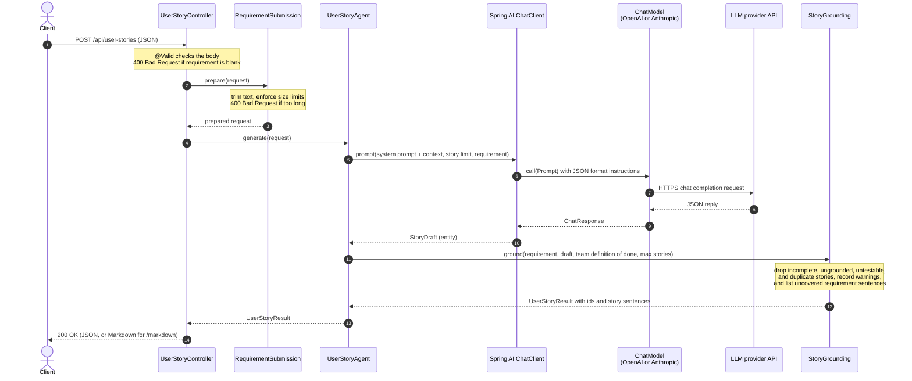

# Spring Boot AI Requirements Agent

A Spring AI service that turns a user requirement into backlog-ready **user stories**, each with **Given/When/Then acceptance criteria**, plus a **definition of done**, the **assumptions** the model made, and **open questions** for the product owner. Send the requirement as JSON and get the result back as JSON, or as Markdown that you can paste into a backlog tool or wiki. After the team has reviewed the stories, you can export them as a **Gherkin feature file** for Cucumber and other BDD tools.

The API works with either **OpenAI** or **Anthropic (Claude)** models. You choose the provider with configuration and need no code changes: set `AI_PROVIDER` to `openai` (the default) or `anthropic`, give the matching API key in `OPENAI_API_KEY` or `ANTHROPIC_API_KEY`, and optionally pick a model with `OPENAI_MODEL` or `ANTHROPIC_MODEL`. Each running instance uses one provider.

The output is a draft for the team to refine, not an approved backlog. The product owner still decides what goes into a sprint.

## How the output is kept honest

Models tend to invent plausible requirements that nobody asked for. The service checks every story before returning it:

- Each story must include a `sourceQuote`: the passage of the requirement it came from. If the quote does not appear in the requirement (whitespace, letter case, and curly quotes are ignored when comparing), the story is dropped.
- A story must have a role, goal, and benefit, plus at least one complete Given/When/Then criterion.
- A story with the same role and goal as an earlier one is dropped as a duplicate.
- At most `requirements.max-stories` stories are returned.

Every dropped story is listed in `warnings`, so nothing disappears without a trace. The service, not the model, assigns the ids (`US-1`, `AC-1.1`) and builds the story sentence ("As a …, I want …, so that …").

The **definition of done** combines two parts. The first is your team's general checklist, configured in `requirements.definition-of-done`. The second is the checks the model found specific to this requirement, such as audit logging or a data migration. Duplicates are removed.

### Requirement coverage

The opposite gap is reported too: requirement text that no story came from. The service splits the requirement into sentences at `.`, `!`, `?`, and line breaks, skips lines with no letters or digits (such as `---`), and lists every sentence that no kept story's `sourceQuote` covers in `uncoveredRequirementText`. A sentence counts as covered when it contains a story's quote or lies inside one, using the same comparison as above. The Markdown output shows the list under "Requirement text not covered by a story".

The check compares quotes, not meaning. A sentence that a story handles only in its acceptance criteria still appears in the list, and an abbreviation such as "e.g." can split a sentence in two. Treat the list as text to review with the product owner, not as an error.

## Tech stack

- Java 25
- Spring Boot 4.1.1 (Web MVC, Validation, Actuator)
- Spring AI 2.0.1 with the OpenAI and Anthropic model starters
- springdoc-openapi 3.1.1 (OpenAPI spec and Swagger UI)
- Maven (wrapper included)

## Getting started

### Prerequisites

- JDK 25
- An API key for the provider you want to use: OpenAI or Anthropic

### Run

| Setting | Values | Default |
|---------|--------|---------|
| `AI_PROVIDER` | `openai` or `anthropic` | `openai` |
| `OPENAI_MODEL` | Any OpenAI chat model | `gpt-4o-mini` |
| `ANTHROPIC_MODEL` | Any Claude model ID | `claude-haiku-4-5` |

Pass the API key as an environment variable. A key given as a command-line argument is visible in the process list and shell history.

OpenAI, Windows PowerShell:

```powershell
$env:OPENAI_API_KEY="sk-..."
.\mvnw.cmd spring-boot:run
```

OpenAI, macOS / Linux:

```bash
export OPENAI_API_KEY="sk-..."
./mvnw spring-boot:run
```

Anthropic Claude, Windows PowerShell:

```powershell
$env:AI_PROVIDER="anthropic"
$env:ANTHROPIC_API_KEY="sk-ant-..."
.\mvnw.cmd spring-boot:run
```

Swagger UI is at `http://localhost:8080/swagger-ui.html`. Health is at `/actuator/health`.

Requirements sent to this service are forwarded to the configured model provider. Do not send confidential material your organization does not allow to leave its network, and do not expose the API on an untrusted network without authentication in front of it.

## Sequence diagram

The flow of a single `POST /api/user-stories` request, from the controller to the LLM and back. The chat model is OpenAI or Anthropic, depending on `AI_PROVIDER`.



If the model call fails, the error goes back to the caller and no partial result is returned.

## API

### Generate user stories

`POST /api/user-stories` returns JSON. `POST /api/user-stories/markdown` takes the same body and returns `text/markdown`.

```json
{
  "requirement": "Customers must be able to cancel an order before it ships. The refund goes back to the original payment method within 5 business days. Shipped orders cannot be cancelled.",
  "context": "Web shop for a mid-size retailer"
}
```

`context` is optional. Use it to describe the product, users, or constraints.

### Response

```json
{
  "summary": "Order cancellation and refunds for customers.",
  "stories": [
    {
      "id": "US-1",
      "title": "Cancel an unshipped order",
      "story": "As a customer, I want to cancel my order before it ships, so that I am not charged for something I no longer want.",
      "role": "customer",
      "goal": "to cancel my order before it ships",
      "benefit": "I am not charged for something I no longer want",
      "priority": "MUST",
      "sourceQuote": "Customers must be able to cancel an order before it ships.",
      "acceptanceCriteria": [
        { "id": "AC-1.1", "given": "an order that has not shipped", "when": "the customer cancels it", "then": "the order status is Cancelled" },
        { "id": "AC-1.2", "given": "an order that has shipped", "when": "the customer tries to cancel it", "then": "the request is refused with a message that shipped orders cannot be cancelled" }
      ]
    }
  ],
  "uncoveredRequirementText": ["Shipped orders cannot be cancelled."],
  "definitionOfDone": [
    "Code is peer reviewed and merged to the main branch",
    "Every acceptance criterion is covered by an automated test that passes in CI",
    "No open critical or major defects remain for the story",
    "User-facing and API documentation is updated",
    "The product owner has accepted the story",
    "Cancellations are written to the audit log"
  ],
  "assumptions": ["Partial cancellation of an order is out of scope"],
  "openQuestions": ["What happens when the original card has expired?"],
  "warnings": []
}
```

`priority` uses MoSCoW: `MUST`, `SHOULD`, `COULD`, or `WONT`. It is `null` when the model gives no usable priority.

In this example, the third sentence of the requirement appears in `uncoveredRequirementText` because no story quotes it, even though `AC-1.2` handles it.

### Export as a Gherkin feature file

`POST /api/user-stories/gherkin` turns user stories into a Gherkin feature file that Cucumber and other BDD tools can read. It returns `text/x-gherkin`.

The endpoint does not take a requirement. It takes a **result**: the JSON returned by `POST /api/user-stories`, after the team has reviewed and edited it. The model is not called, so the export is fast, costs nothing, and always matches the stories you send. Calling it twice with the same body gives the same file.

#### Workflow

1. Generate stories with `POST /api/user-stories` and save the response.
2. Review it with the product owner: fix wording, remove stories, add or change acceptance criteria.
3. Send the edited result to `POST /api/user-stories/gherkin` and save the response as a `.feature` file.

With `curl` (in Windows PowerShell, type `curl.exe`, because `curl` is an alias for `Invoke-WebRequest`):

```bash
curl -s -X POST localhost:8080/api/user-stories \
  -H "Content-Type: application/json" -d @requirement.json -o stories.json

# review and edit stories.json

curl -s -X POST localhost:8080/api/user-stories/gherkin \
  -H "Content-Type: application/json" -d @stories.json -o order-cancellation.feature
```

#### Request

The body has the same shape as the response above. The export reads only these fields, so you can send the full result or a hand-written body with just these:

| Field | Required | Used for |
|-------|----------|----------|
| `summary` | No | The `Feature` name. When it is missing or blank, the name is `User stories`. |
| `stories` | **Yes**, at least one | One `Rule` per story, in the order given. |
| `stories[].id` | No | The rule name and the first tag of each scenario. |
| `stories[].title` | No | The rule name, after the id. |
| `stories[].story` | No | A description line under the rule. |
| `stories[].priority` | No | A tag on each scenario: `MUST`, `SHOULD`, `COULD`, or `WONT`. |
| `stories[].acceptanceCriteria` | No | One `Scenario` per criterion. |
| `acceptanceCriteria[].id` | No | The scenario name and a tag. |
| `acceptanceCriteria[].given`, `when`, `then` | **Yes**, all three | The `Given`, `When`, and `Then` steps. |

All other fields (`role`, `goal`, `benefit`, `sourceQuote`, `uncoveredRequirementText`, `definitionOfDone`, `assumptions`, `openQuestions`, `warnings`) are ignored. A minimal body:

```json
{
  "stories": [
    {
      "id": "US-1",
      "title": "Cancel an unshipped order",
      "acceptanceCriteria": [
        { "id": "AC-1.1", "given": "an order that has not shipped", "when": "the customer cancels it", "then": "the order status is Cancelled" }
      ]
    }
  ]
}
```

#### Response

For the example result above, the export returns:

```gherkin
Feature: Order cancellation and refunds for customers.

  Rule: US-1: Cancel an unshipped order
    As a customer, I want to cancel my order before it ships, so that I am not charged for something I no longer want.

    @US-1 @AC-1.1 @MUST
    Scenario: AC-1.1: the customer cancels it
      Given an order that has not shipped
      When the customer cancels it
      Then the order status is Cancelled

    @US-1 @AC-1.2 @MUST
    Scenario: AC-1.2: the customer tries to cancel it
      Given an order that has shipped
      When the customer tries to cancel it
      Then the request is refused with a message that shipped orders cannot be cancelled
```

How each part is built:

- **Feature:** one per file, named after `summary`.
- **Rule:** one per story, named `<id>: <title>`. If one of the two is missing, the other is used alone. A story with no usable criteria still gets its rule, with no scenarios under it, so you can see it needs criteria.
- **Scenario:** one per criterion, named `<criterion id>: <when>`, with the `Given`, `When`, and `Then` steps in that order.
- **Tags:** each scenario is tagged with the story id, the criterion id, and the priority, for example `@US-1 @AC-1.1 @MUST`. Run a subset with Cucumber tag expressions such as `@MUST` or `@US-1 and not @WONT`. Gherkin tags cannot contain spaces, so spaces and `@` are removed from ids (`US 1` becomes `@US1`). Missing values are left out, and a scenario with no tags at all gets no tag line.

#### Cleaning and skipping

Gherkin is line based, so the export keeps edited text from breaking the file:

- Line breaks and repeated whitespace inside any value are collapsed to single spaces.
- A criterion with a missing or blank `given`, `when`, or `then` is skipped, because it cannot form a complete scenario. `null` entries in `stories` or `acceptanceCriteria` are skipped too.
- Text is copied as written. If you edit a step to start with its keyword, such as `"given": "Given an order"`, the file contains `Given Given an order`. Write the clause without the keyword, as the generate endpoint does.

#### Errors

The request is rejected with **400 Bad Request** when `stories` is missing or empty, or when the body is not valid JSON. No other field is validated: the export does its best with whatever the team sends.

#### Running the scenarios

The steps are written in plain language, so the feature file is a specification, not runnable tests. Your team still writes the step definitions that connect each step to the application. The `Rule` keyword needs a Cucumber version that supports Gherkin 6 or later.

### Configuration

| Property | Default |
|----------|---------|
| `requirements.max-requirement-characters` | 20000 |
| `requirements.max-context-characters` | 4000 |
| `requirements.max-stories` | 10 |
| `requirements.definition-of-done[n]` | Five general items, listed in `application.properties` |

Replace the `requirements.definition-of-done` list with your team's own definition of done.

## Tests

```bash
./mvnw verify
```

On Windows: `.\mvnw.cmd verify`.

The tests use a stub chat model. They do not call OpenAI or Anthropic. The JaCoCo coverage report is at `target/site/jacoco/index.html`.
